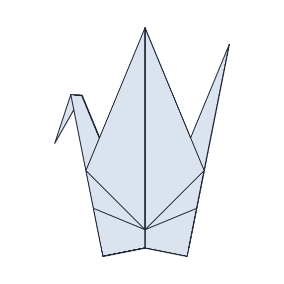
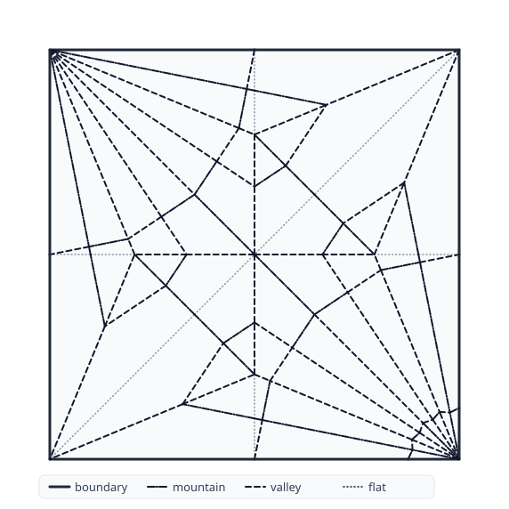

<p align="center">
  <picture>
    <source media="(prefers-color-scheme: dark)" srcset="packages/www/public/brand/mark-dark.svg">
    
  </picture>
</p>

<h1 align="center">beloch</h1>

<p align="center">
<a href="https://belochlang.org/">Website</a> ·
<a href="https://belochlang.org/playground/"><b>Playground</b></a> ·
<a href="https://doi.org/10.5281/zenodo.22884252"></a>
</p>

Beloch is a programming language for origami. A program writes a folding sequence step by step, the way a diagram shows it: fold this corner onto that line, squash this flap, reverse that point. Beloch folds the paper along with it and computes the exact folded state after every step.

Beloch only folds. It returns the folded paper after each step as a standard [FOLD](https://github.com/edemaine/fold) file that other origami software opens as well. Its own renderer, on the command line and in the browser, draws that file as a crease pattern, as the folded model or as a folding diagram.

## The traditional crane

<table>
<tr>
<td width="50%">

```
paper square
fold (map .d onto .b) as --ac
fold (map .a onto .c) as --bd

squash (--ac & --ab onto --bd) as --s1
flip
squash (--ac & --bc onto --bd) as --s2
flip

.o = --ac * --bd
mark (through .c .o) as --mid
.sr = --ab * --s1
.sl = --da * --s1
.br = --bc * --s2
.bl = --cd * --s2

flatten (fan (--s1 & .sr)
             (map .sr onto --mid through .a valley) as .e1)
        (fan (--s1 & .sl)
             (map .sl onto --mid through .a valley) as .e2)
        (staying .o) as --pf
flatten (fan (--s2 & .br)
             (map .br onto --mid through .c valley) as .e3)
        (fan (--s2 & .bl)
             (map .bl onto --mid through .c valley) as .e4)
        (staying .o) as --pb

.ht = free on --[.e2 .a] from .a at 1/3

fold (map --[.e1 .b] onto --mid)
     (moving .e1) (up to #[.e1 .b .o]) as --n1
fold (map --[.e2 .d] onto --mid)
     (moving .e2) (up to #[.e2 .d .o]) as --n2
fold (map --[.e3 .b] onto --mid)
     (moving .e3) (up to #[.e3 .b .o]) (mountain) as --n3
fold (map --[.e4 .d] onto --mid)
     (moving .e4) (up to #[.e4 .d .o]) (mountain) as --n4

.pn = free on --n1 & #[.sr .b] from .b at 1/4
.pn3 = free on --n3 & #[.br .b] from .b at 1/4
reverse (perp --n1 through .sr) (moving .b)
        (--n1 & .pn mountain)
        (--n3 & .pn3 mountain) as --neck

.pt = free on --n2 & #[.sl .d] from .d at 1/4
.pt4 = free on --n4 & #[.bl .d] from .d at 1/4
reverse (perp --n2 through .sr) (moving .d)
        (--n2 & .pt mountain)
        (--n4 & .pt4 mountain) as --tail

.hp = free on --bd & .b from .b at 1/4
reverse (through .hp .ht) (moving .b) as --head

@orient .o .c up
```

</td>
<td width="50%">





</td>
</tr>
</table>

[How to read the crane](https://belochlang.org/guide/reading-the-crane/) walks through this program step by step.

## Citing

```bibtex
@software{muehl_beloch,
  author  = {M{\"u}hl, Christopher},
  title   = {Beloch: origami folding sequences as programs},
  year    = {2026},
  doi     = {10.5281/zenodo.22884252},
  url     = {https://github.com/tophcodes/beloch}
}
```

## Name

Beloch is named after [Margherita Piazzola Beloch][mpb], whose 1936 work
showed that folding solves general cubic equations. Axiom 7 is the Beloch
fold.

[mpb]: https://en.wikipedia.org/wiki/Margherita_Piazzola_Beloch

Licensed MIT ([`LICENSE.md`](LICENSE.md)).
